  

  
  
  
  

## 👨‍💻 About me

I build **end-to-end data pipelines, from ERP extraction to Power BI reporting**. At **Nobles** I designed the warehouse data model and run the daily **Apache Airflow** pipelines that feed the KPI dashboards stakeholders use to make decisions every day. I hold a **BSc in Artificial Intelligence**, so machine learning is part of my toolkit too.

- 🏢 **Data Engineer** at Nobles (remote, Kuwait)
- 📊 Former **BI Developer Intern** at Al-Ahly Momkn for E-Payments
- 🎓 **BSc in IT, Artificial Intelligence**, Misr University for Science and Technology (CGPA 3.39)
- 🤝 AI Technical Team member, **Google Developer Student Clubs** MUST (2022–2023)
- 🌍 Arabic (native) · English (fluent)

  

## 💼 Experience

### 🛠️ Data Engineer · Nobles
📍 Remote, Kuwait · Mar 2026 – Present

- Extract data from **Odoo (ERP)**, the source system for the company's data platform
- Clean and validate it in **Python**, handling missing values and outliers to keep warehouse tables accurate
- Designed the **data model** and load curated tables into the **data warehouse**
- Orchestrate the full pipeline as **daily batch runs with Apache Airflow DAGs**
- Connect the warehouse to **Power BI** and build the DAX measures and KPIs stakeholders use for daily decisions

### 📊 BI Developer Intern · Al-Ahly Momkn for E-Payments
📍 Cairo, Egypt · Oct 2024 – Dec 2024

- Built automated daily, weekly and monthly dashboards with **SQL Server, Python and Power BI**
- Designed and maintained **ETL pipelines** that kept reporting consistent and reliable
- Implemented **Apache Airflow DAGs** to orchestrate workflows and cut manual reporting work

## 🧰 Tech stack

| Area | Tools |
|---|---|
| **Languages** |   |
| **Data engineering** |     |
| **BI & visualization** |   |
| **Databases & tools** |      |
| **Containers** |   |
| **Version control** |   |
| **AI & ML** |    |

Core knowledge: statistics · probability · linear algebra · data analysis

## 🚀 Featured projects

<table>
<tr>
<td width="50%" valign="top">

<h3><a href="https://github.com/AhmedAbozaid94/uber-ride-analytics-powerbi">🚖 Uber Ride Analytics</a></h3>

Power BI dashboard over <b>150K ride bookings</b>: Power Query cleaning, a star schema, 12 DAX measures, Deneb (Vega) visuals and an animated landing page.

   
</td>
<td width="50%" valign="top">
<h3><a href="https://github.com/AhmedAbozaid94/NLP-For-Sentiment-Analysis">🎙️ NLP for Sentiment Analysis</a></h3>

<i>Graduation project.</i> Multimodal sentiment analysis of text and speech: DistilBERT for text (<b>92% accuracy</b>) and a CNN-LSTM for audio emotions (<b>89% accuracy</b>), served in a Gradio web app for real-time predictions.

   
  
<h3><a href="https://github.com/AhmedAbozaid94/TrashVision">♻️ TrashVision</a></h3>

Deep learning waste classifier (<b>0.91 F1</b>) deployed as a REST API and wired into a hardware prototype with a team of 4 engineers.

  
</td>
</tr>
</table>

<b>🏅 Certificates</b>

 

| Certificate | Issuer |
|---|---|
| Prepare, Clean, Transform, and Load Data using Power BI | Coursera |
| Supervised Machine Learning | Coursera |
| Foundations: Data, Data, Everywhere | Coursera |
| Database Fundamentals | MaharaTech |
| IoT Fundamentals: Connecting Things | Cisco Networking Academy |
| Python Programming | IGATE |

## 📈 GitHub activity

  

  <picture>
    <source media="(prefers-color-scheme: dark)" srcset="https://raw.githubusercontent.com/AhmedAbozaid94/AhmedAbozaid94/output/github-snake-dark.svg"/>
    <source media="(prefers-color-scheme: light)" srcset="https://raw.githubusercontent.com/AhmedAbozaid94/AhmedAbozaid94/output/github-snake.svg"/>
    
  </picture>

  

